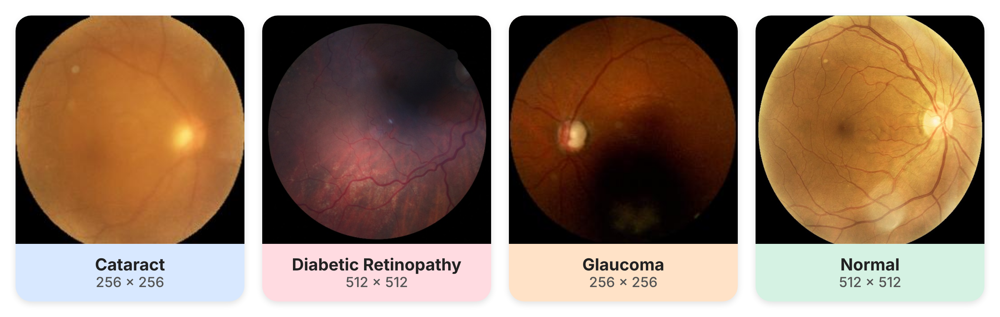
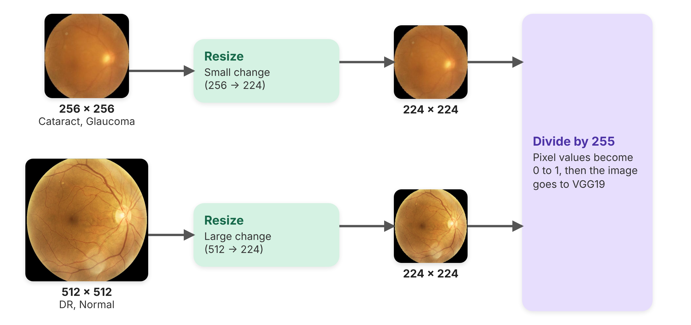
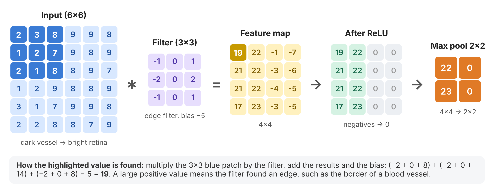
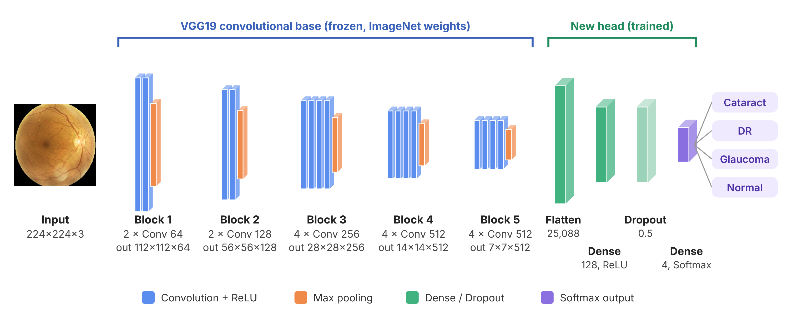
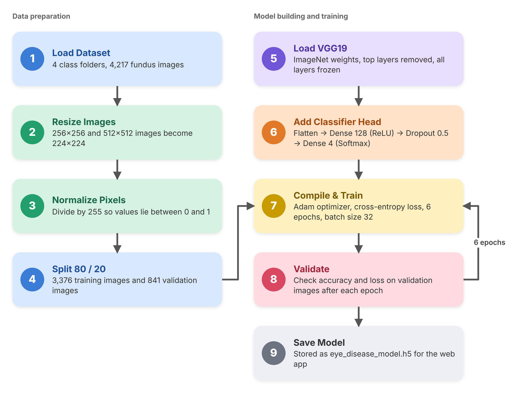
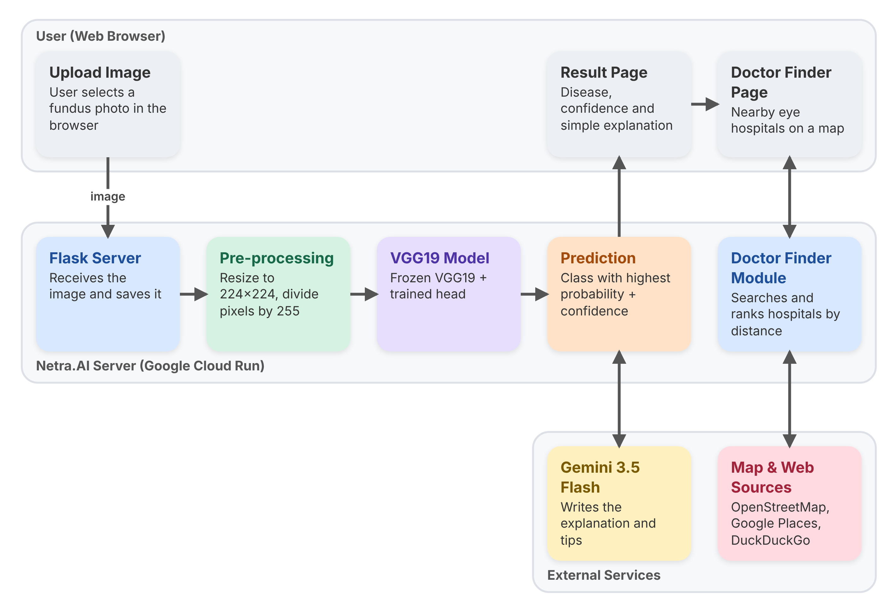
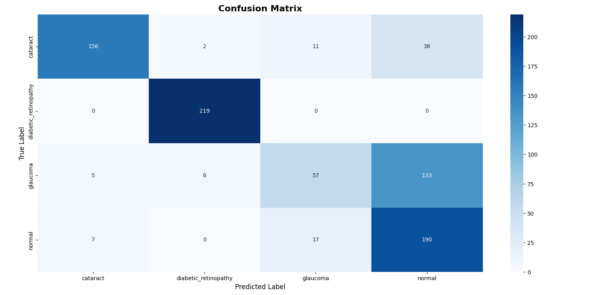
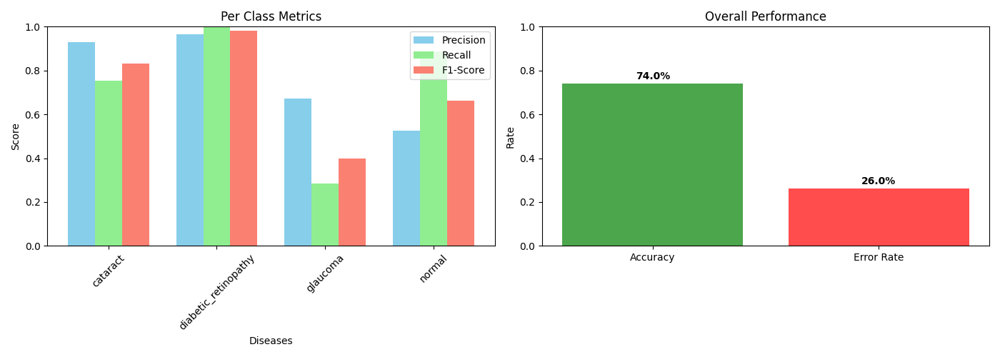

## 📦 Resources & Downloads

Access all project assets below:

| 📁 Resource | 🔗 Link |
|------------|--------|
| **Full Project Files** | [Download from Google Drive](https://drive.google.com/drive/folders/114aQBVpgpO28DCk9NpD9S04oqb7FNaiZ?usp=drive_link) |
| **Dataset** | [Download Dataset](https://drive.google.com/drive/folders/1ymXL4kkdRdPp8_jcvEstDd4ShfDOMoI4?usp=drive_link) |
| **Pretrained Model** | [Download Model](https://drive.google.com/drive/folders/1C8uVeAcoeW60-rZ4D5ergSxjUNqS0QXn?usp=drive_link) |

---

### 💡 Notes
- The **Full Project Files** include code, configs, and supporting assets.
- The **Dataset** is required for training and evaluation.
- The **Pretrained Model** can be used directly for inference.

## 🎥 Demo Video
https://github.com/user-attachments/assets/544d33e8-d097-42ba-9c9e-d06e9e7a2c58

---

<div align="center">

# 👁️ Netra.AI

### Detection of Retinal Diseases from Fundus Images using VGG19 Transfer Learning

🧠 **Deep Learning Mini-Project**

</div>

---

## 📋 Table of Contents

1. [📝 Abstract](#1--abstract)
2. [📖 Introduction](#2--introduction)
3. [🎯 Problem Statement](#3--problem-statement)
4. [📚 Literature Survey](#4--literature-survey)
5. [🗂️ Dataset](#5-️-dataset)
6. [🔧 Data Pre-processing](#6--data-pre-processing)
7. [🏗️ Model Architecture](#7-️-model-architecture)
8. [⚙️ Model Training](#8-️-model-training)
9. [💻 System Implementation](#9--system-implementation)
10. [📊 Results](#10--results)
11. [🔍 Observations](#11--observations)
12. [✅ Conclusion](#12--conclusion)
13. [🚀 Future Scope](#13--future-scope)
14. [📁 Project Structure](#14--project-structure)
15. [🛠️ Installation and Usage](#15-️-installation-and-usage)
16. [📑 References](#16--references)

---

## 1. 📝 Abstract

Cataract, diabetic retinopathy and glaucoma are some of the most common causes of vision loss, and all three can be seen on a photograph of the back of the eye, called a **fundus image**. Reading these images needs an eye specialist, and there are not enough specialists for the number of patients who need screening.

**Netra.AI** is a web application that uses deep learning to classify a fundus image into one of four classes: **Cataract**, **Diabetic Retinopathy**, **Glaucoma** or **Normal**. The model is based on **VGG19**, a convolutional neural network pre-trained on ImageNet. Using transfer learning, the convolutional layers of VGG19 are kept frozen and only a small classification head (Flatten → Dense 128 → Dropout 0.5 → Dense 4) is trained. The dataset has **4,217 images** in two sizes (256×256 and 512×512), all resized to 224×224 before training.

On the validation set of 841 images, the model achieves an overall accuracy of **73.96%**. It detects diabetic retinopathy very well (F1-score 98.21%) and cataract well (F1-score 83.20%), but often confuses glaucoma with normal eyes. After prediction, the application uses the **Google Gemini 3.5 Flash API** to explain the result in simple language and a web scraping module to list nearby eye hospitals. The application is hosted on **Google Cloud Run**.

**Keywords:** Deep Learning, CNN, VGG19, Transfer Learning, Fundus Image, Diabetic Retinopathy, Glaucoma, Cataract, Gemini API, Cloud Run

---

## 2. 📖 Introduction

### 2.1 Background

The WHO estimates that more than **2.2 billion** people have some form of visual impairment, and roughly half of these cases could have been avoided or are still untreated. Cataract remains the biggest single cause of blindness, diabetic retinopathy cases keep growing with the number of diabetics, and glaucoma patients are projected to cross **111 million by 2040**.

All three diseases show visible signs on a fundus image. Taking such a photograph is cheap and quick, but reading it needs an ophthalmologist, who is often not available in smaller towns.

### 2.2 Motivation

CNNs have shown very good results in medical image classification. Gulshan et al. showed that a CNN can detect diabetic retinopathy as accurately as eye doctors. This project builds a smaller version of such a system and applies the core topics of the Deep Learning subject — CNNs, transfer learning, activation functions, loss functions, optimizers, dropout and model evaluation — to a real problem.

### 2.3 Objectives

1. Build a CNN model that classifies fundus images into Cataract, Diabetic Retinopathy, Glaucoma and Normal.
2. Use transfer learning with pre-trained VGG19, since the dataset is small.
3. Pre-process images of different sizes into the 224×224 input required by VGG19.
4. Evaluate the model using accuracy, precision, recall, F1-score and the confusion matrix.
5. Give a simple explanation of the result using the Gemini API and show nearby eye hospitals.
6. Deploy the complete application on Google Cloud Run.

### 2.4 Scope

Netra.AI is an **educational prototype** and not a certified medical device. It assists doctors and users but does not replace a proper eye examination. The model gives one label per image, so it cannot report two diseases in the same eye.

---

## 3. 🎯 Problem Statement

> *To develop a deep learning based system that takes a colour fundus image as input, classifies it as Cataract, Diabetic Retinopathy, Glaucoma or Normal using a VGG19 transfer learning model, and gives the user an easy explanation of the result along with nearby eye specialist details.*

### 3.1 Challenges

| Challenge | How Netra.AI Handles It |
|---|---|
| Disease signs are small and look similar to each other | A deep CNN (VGG19) learns these features automatically |
| Dataset is small (about 4,200 images) | Transfer learning with frozen VGG19 layers |
| Images come in two different sizes | All images are resized to 224×224 |
| Model may overfit the training data | Dropout layer and a separate validation set |
| Users cannot understand model output | Gemini API gives a simple explanation |
| User does not know where to go next | Doctor finder shows nearby eye hospitals |

---

## 4. 📚 Literature Survey

| Paper | Method | Finding |
|---|---|---|
| Krizhevsky et al., 2012 | AlexNet | Deep CNNs work far better than older methods on ImageNet |
| Simonyan & Zisserman, 2015 | VGG16 / VGG19 | Deeper networks with 3×3 filters give better accuracy |
| He et al., 2016 | ResNet | Skip connections allow very deep networks |
| Yosinski et al., 2014 | Transfer learning study | Early CNN layers are general and can be reused |
| Gulshan et al., 2016 | Inception-v3 | DR detection at specialist level on a very large dataset |
| Ting et al., 2017 | CNN ensemble | Detection of DR, glaucoma and other eye diseases |

Most of these systems use very large private datasets. This project uses a small public dataset and a simple, well-known model (VGG19), and adds an explanation and doctor finder for the user.

---

## 5. 🗂️ Dataset

### 5.1 Dataset Details

The public **Eye Diseases Classification** dataset from Kaggle is used. It contains colour fundus images in four folders, one per class.

🔗 **Dataset Link:** [https://www.kaggle.com/datasets/gunavenkatdoddi/eye-diseases-classification](https://www.kaggle.com/datasets/gunavenkatdoddi/eye-diseases-classification)

| Class | No. of Images | Image Size |
|---|:---:|:---:|
| Cataract | 1038 | 256 × 256 |
| Diabetic Retinopathy | 1098 | 512 × 512 |
| Glaucoma | 1007 | 256 × 256 |
| Normal | 1074 | 512 × 512 |
| **Total** | **4217** | – |

The classes are almost balanced: the largest class (DR) has only about 9% more images than the smallest class (Glaucoma). All images are RGB colour images in JPG or PNG format.

<p align="center">
  
  <br><em>Figure 1: Sample images from each class</em>
</p>

### 5.2 Features of Each Class

| Class | Features Seen in the Fundus Image |
|---|---|
| Cataract | Whole image looks hazy and blurred, blood vessels are not clear |
| Diabetic Retinopathy | Small red spots (haemorrhages), yellow spots (exudates), abnormal blood vessels |
| Glaucoma | Larger and paler cup inside the optic disc (high cup-to-disc ratio) |
| Normal | Clear blood vessels, sharp optic disc and darker macula |

### 5.3 Training and Validation Split

The data is split using `ImageDataGenerator(validation_split=0.2)`, which splits every class folder separately (80% training, 20% validation).

| Class | Total | Training | Validation |
|---|:---:|:---:|:---:|
| Cataract | 1038 | 831 | 207 |
| Diabetic Retinopathy | 1098 | 879 | 219 |
| Glaucoma | 1007 | 806 | 201 |
| Normal | 1074 | 860 | 214 |
| **Total** | **4217** | **3376** | **841** |

---

## 6. 🔧 Data Pre-processing

The same steps are applied during training and in the web application, so the model always receives input in the same form.

1. **Resize** – the image is resized to 224×224 pixels.
2. **Convert** – the image is converted to an array of RGB pixel values.
3. **Normalize** – each pixel value is divided by 255 so it lies between 0 and 1.
4. **Batch** – images are grouped into batches of 32 for training. For a single upload, the input shape becomes `(1, 224, 224, 3)`.

### 6.1 Resizing 256×256 and 512×512 Images to 224×224

- During training: `flow_from_directory(target_size=(224, 224))`
- During prediction: `image.load_img(path, target_size=(224, 224))`

Keras uses nearest-neighbour interpolation by default. Since all images are square, nothing is stretched or cropped and the full eye stays visible.

| Original Size | Classes | Scale Factor | Effect |
|---|---|:---:|---|
| 256 × 256 | Cataract, Glaucoma | 1.14 | Small reduction, most detail is kept |
| 512 × 512 | DR, Normal | 2.29 | Large reduction, some fine detail is lost |

<p align="center">
  
  <br><em>Figure 2: Resizing images of two sizes to 224×224</em>
</p>

### 6.2 Why 224×224?

- VGG19 was trained on ImageNet images of size 224×224, so its filters work best at this size.
- VGG19 has 5 pooling layers: 224 → 112 → 56 → 28 → 14 → 7, giving a final feature map of **7×7×512**, which the Flatten and Dense layers are built for.
- It keeps memory and computation small enough for training and cloud deployment.

### 6.3 Normalization

Pixel values (0–255) are divided by 255 using `rescale=1./255`. Small input values make training more stable. **No data augmentation** was used in this project.

---

## 7. 🏗️ Model Architecture

### 7.1 Convolutional Neural Network (CNN)

| Layer | Function |
|---|---|
| Convolution | A 3×3 filter slides over the image and produces a feature map; each filter detects one pattern (edge, colour change) |
| ReLU | `ReLU(x) = max(0, x)`; adds non-linearity |
| Max Pooling | Takes the largest value in each 2×2 block; halves the feature map size |
| Dense (Fully Connected) | Uses all extracted features to make the final decision |
| Softmax | Converts outputs into probabilities that add up to 1 |

<p align="center">
  
  <br><em>Figure 3: Example of convolution, ReLU and max pooling</em>
</p>

### 7.2 Why VGG19?

1. **Simple structure** – only 3×3 convolutions and 2×2 pooling, repeated in 5 blocks.
2. **Good pre-trained features** – trained on over 1 million ImageNet images.
3. **Works with small datasets** – only the small head needs training.
4. **Deeper than VGG16** – blocks 3, 4 and 5 have 4 convolution layers instead of 3.
5. **Easy to use** – available directly in Keras with pre-trained weights.

| Model | Size (MB) | Parameters | Top-1 Acc. | Depth |
|---|:---:|:---:|:---:|:---:|
| VGG16 | 528 | 138.4 M | 71.3% | 16 |
| **VGG19 (used)** | **549** | **143.7 M** | **71.3%** | **19** |
| ResNet50 | 98 | 25.6 M | 74.9% | 107 |
| InceptionV3 | 92 | 23.9 M | 77.9% | 189 |
| MobileNetV2 | 14 | 3.5 M | 71.3% | 105 |
| EfficientNetB0 | 29 | 5.3 M | 77.1% | 132 |

*Values from Keras Applications.* Most of VGG19's parameters are in its original fully connected layers, which are not used (`include_top=False`). The part used has about 20 million parameters.

### 7.3 VGG19 Architecture

<p align="center">
  
  <br><em>Figure 4: VGG19 architecture with the custom classification head</em>
</p>

| Block | Layers | Output Size | Parameters |
|---|---|:---:|---:|
| Input | RGB image | 224×224×3 | 0 |
| Block 1 | 2 Conv (64 filters) + MaxPool | 112×112×64 | 38,720 |
| Block 2 | 2 Conv (128 filters) + MaxPool | 56×56×128 | 221,440 |
| Block 3 | 4 Conv (256 filters) + MaxPool | 28×28×256 | 2,065,408 |
| Block 4 | 4 Conv (512 filters) + MaxPool | 14×14×512 | 8,259,584 |
| Block 5 | 4 Conv (512 filters) + MaxPool | 7×7×512 | 9,439,232 |
| Flatten | Converts to 1-D vector | 25,088 | 0 |
| Dense | 128 neurons, ReLU | 128 | 3,211,392 |
| Dropout | Rate 0.5 | 128 | 0 |
| Dense (Output) | 4 neurons, Softmax | 4 | 516 |
| **Total parameters** | | | **23,236,292** |
| Frozen (VGG19 layers) | | | 20,024,384 |
| Trainable (custom head) | | | 3,211,908 |

### 7.4 Layer-by-Layer Working

| Stage | What It Learns |
|---|---|
| Block 1 | Simple features: edges, borders of blood vessels, colour changes |
| Block 2 | Small textures and thin vessel lines; small red and yellow spots |
| Block 3 | Larger patterns: vessel branches, groups of spots, hazy look of cataract |
| Block 4 | Bigger structures: optic disc, areas with many lesions |
| Block 5 | Overall appearance of the eye |
| Flatten + Dense | Maps the 25,088 features to the 4 classes; Dropout turns off 50% of neurons during training to reduce overfitting |

### 7.5 Transfer Learning

VGG19 is loaded with ImageNet weights and all its layers are frozen, so it acts only as a feature extractor. Only the new head (≈3.2 million parameters) is trained.

```python
base_model = VGG19(weights="imagenet", include_top=False, input_shape=(224, 224, 3))
for layer in base_model.layers:
    layer.trainable = False  # Freeze pretrained layers

x = Flatten()(base_model.output)
x = Dense(128, activation='relu')(x)
x = Dropout(0.5)(x)
output = Dense(len(CATEGORIES), activation='softmax')(x)

model = Model(inputs=base_model.input, outputs=output)
```

---

## 8. ⚙️ Model Training

### 8.1 Training Pipeline

<p align="center">
  
  <br><em>Figure 5: Model training pipeline</em>
</p>

### 8.2 Training Parameters

| Parameter | Value |
|---|---|
| Base model | VGG19 (ImageNet weights, frozen) |
| Input size | 224 × 224 × 3 |
| Optimizer | Adam (learning rate 0.001) |
| Loss function | Categorical Cross-Entropy |
| Epochs | 6 |
| Batch size | 32 |
| Steps per epoch | 106 |
| Train / Validation split | 80% / 20% |
| Data augmentation | Not used |
| Saved model | `models/eye_disease_model.h5` |

### 8.3 Loss Function and Optimizer

**Categorical Cross-Entropy** is used because this is a multi-class problem with one-hot labels:

```
Loss = − log(p_correct_class)
```

The loss is small when the model gives a high probability to the correct class and large when it does not.

**Adam** updates each weight using the average of recent gradients and adjusts the step size for each weight automatically, so it usually trains faster and more smoothly than plain gradient descent.

### 8.4 Training Steps

1. Load images with `ImageDataGenerator` (rescale and 80/20 split).
2. Load VGG19 without its top layers and freeze all its layers.
3. Add the head: Flatten → Dense(128, ReLU) → Dropout(0.5) → Dense(4, Softmax).
4. Compile with Adam and categorical cross-entropy.
5. Train for 6 epochs with batch size 32, checking validation accuracy after every epoch.
6. Save the model as `eye_disease_model.h5`.

```python
datagen = ImageDataGenerator(rescale=1./255, validation_split=0.2)

train_data = datagen.flow_from_directory(DATASET_PATH, target_size=IMG_SIZE,
    batch_size=BATCH_SIZE, class_mode='categorical', subset="training")
val_data = datagen.flow_from_directory(DATASET_PATH, target_size=IMG_SIZE,
    batch_size=BATCH_SIZE, class_mode='categorical', subset="validation")

model.compile(optimizer='adam', loss='categorical_crossentropy', metrics=['accuracy'])
history = model.fit(train_data, validation_data=val_data, epochs=EPOCHS)
model.save("models/eye_disease_model.h5")
```

---

## 9. 💻 System Implementation

### 9.1 System Architecture

The user uploads a fundus photo from the browser. The Flask server pre-processes it the same way as during training and passes it to the VGG19 model. The predicted disease and confidence are sent to the Gemini API, which returns a short explanation. Both are shown on the result page, from where the user can open the doctor finder.

<p align="center">
  
  <br><em>Figure 6: System architecture of Netra.AI</em>
</p>

### 9.2 Prediction in the Web Application

The saved model is loaded into memory once when the server starts. For every uploaded image, the server:

1. Resizes the image to 224×224 and divides pixel values by 255.
2. Adds a batch dimension → input shape `(1, 224, 224, 3)`.
3. Runs the model, which returns four probabilities (one per class).
4. Picks the class with the highest probability and shows it as the confidence in percent.

The probabilities of all four classes are also displayed as bars.

### 9.3 Gemini 3.5 Flash API

The disease name and confidence are passed to **Gemini 3.5 Flash** through the `google-genai` Python library. The model is asked to answer in a fixed JSON format with five parts:

| Field | Content |
|---|---|
| `description` | Short description of the disease |
| `symptoms` | Common symptoms |
| `risk_factors` | Risk factors |
| `next_steps` | Recommended next steps |
| `lifestyle_tips` | Lifestyle tips |

If the API is busy, the request is retried a few times. If it still fails, a ready-made text stored in the code is shown instead.

### 9.4 Doctor Finder (Web Scraping)

`web_scraper.py` takes a city name and returns up to **15 eye hospitals** near it.

| Source | Use |
|---|---|
| City coordinate list | Stored latitude and longitude of 54 Indian cities |
| Nominatim (OpenStreetMap) | Location of cities not in the list |
| Google Places API | Hospitals with ratings and phone numbers (only if a key is given) |
| Overpass API (OpenStreetMap) | Eye hospitals and clinics within 25 km |
| Curated list | Verified eye hospitals for 14 large cities |
| DuckDuckGo search | Official website link of a hospital |

Duplicate hospitals are removed, the distance from the city centre is calculated, and results are sorted closest first. They are shown as cards and as markers on a Leaflet map.

### 9.5 Technologies Used

| Technology | Purpose |
|---|---|
| Python 3.10 | Main programming language |
| TensorFlow / Keras 2.15 | Building, training and running the model |
| NumPy, scikit-learn | Array handling and evaluation metrics |
| Matplotlib, Seaborn | Graphs and confusion matrix |
| Flask | Web server |
| Google Gemini 3.5 Flash | Explanation of the result |
| Requests, BeautifulSoup | Web scraping for the doctor finder |
| HTML, CSS, JavaScript, Leaflet.js | User interface and map |
| Docker, Google Cloud Run | Containerization and hosting |

### 9.6 Hosting

The application, together with the trained model, is packed into a Docker container and hosted on **Google Cloud Run**, so it can be opened from any browser through a public link.

---

## 10. 📊 Results

### 10.1 Evaluation Metrics

The model was evaluated on the **841 validation images** using `evaluate_model.py`.

| Term | Meaning |
|---|---|
| TP (True Positive) | Images of the class predicted correctly |
| FP (False Positive) | Images of other classes wrongly predicted as this class |
| FN (False Negative) | Images of this class predicted as another class |
| TN (True Negative) | Images of other classes correctly not predicted as this class |

```
Accuracy   = Correct Predictions / Total Predictions
Error Rate = 1 − Accuracy
Precision  = TP / (TP + FP)
Recall     = TP / (TP + FN)
F1-Score   = 2 × (Precision × Recall) / (Precision + Recall)
```

### 10.2 Overall Performance

| Metric | Value |
|---|:---:|
| **Accuracy** | **73.96%** |
| Error Rate | 26.04% |
| Weighted Precision | 77.40% |
| Weighted Recall | 73.96% |
| Weighted F1-Score | 72.39% |

The model predicted **622 out of 841** validation images correctly.

### 10.3 Class-wise Performance

| Class | Precision (%) | Recall (%) | F1-Score (%) |
|---|:---:|:---:|:---:|
| Cataract | 92.86 | 75.36 | 83.20 |
| Diabetic Retinopathy | 96.48 | 100.00 | 98.21 |
| Glaucoma | 67.06 | 28.36 | 39.86 |
| Normal | 52.63 | 88.79 | 66.09 |

### 10.4 Confusion Matrix

Rows = actual class, columns = predicted class.

| | Cataract | DR | Glaucoma | Normal |
|---|:---:|:---:|:---:|:---:|
| **Cataract** | **156** | 2 | 11 | 38 |
| **DR** | 0 | **219** | 0 | 0 |
| **Glaucoma** | 5 | 6 | **57** | 133 |
| **Normal** | 7 | 0 | 17 | **190** |

<p align="center">
  
  <br><em>Figure 7: Confusion matrix heatmap</em>
</p>

| Class | TP | FP | FN | TN |
|---|:---:|:---:|:---:|:---:|
| Cataract | 156 | 12 | 51 | 622 |
| Diabetic Retinopathy | 219 | 8 | 0 | 614 |
| Glaucoma | 57 | 28 | 144 | 612 |
| Normal | 190 | 171 | 24 | 456 |

<p align="center">
  
  <br><em>Figure 8: Class-wise metrics and overall performance</em>
</p>

---

## 11. 🔍 Observations

### 11.1 Classes That Worked Well

- **Diabetic Retinopathy (F1: 98.21%)** – all 219 DR validation images were identified. DR leaves many red and yellow marks across the retina, which VGG19 filters respond to easily.
- **Cataract (F1: 83.20%)** – precision of 92.86% means the model is rarely wrong when it predicts cataract. The 38 cataract images marked Normal are probably early cases where the haze is very faint.

### 11.2 Classes That Did Not Work Well

- **Glaucoma (Recall: 28.36%)** – of 201 glaucoma images, 133 were labelled Normal. This is the most serious error, because a glaucoma patient would be told the eye is fine.
- **Normal (Precision: 52.63%)** – the model predicted "Normal" 361 times when only 214 images were really normal; most of the extra predictions were glaucoma images.

### 11.3 Why the Final Accuracy Is Lower

An accuracy of 73.96% is far better than random guessing (25% for four classes), but lower than desired. The main reasons are:

1. **Glaucoma pulls the average down** – excluding glaucoma, the model gets 565 of 640 images right (about 88%).
2. **VGG19 layers were frozen** – features learned from ImageNet were never adjusted for retinal images.
3. **The glaucoma sign is very small** – it mainly changes the cup inside the optic disc, so the image as a whole looks close to normal.
4. **Detail lost while resizing** – 512×512 images lose fine detail such as thin vessels and tiny spots.
5. **Short training** – 6 epochs were enough for DR and cataract, but not for the harder glaucoma–normal distinction.
6. **No data augmentation** – the model saw less variety.
7. **Different input scaling** – VGG19 was trained with its own preprocessing (mean subtraction), while only division by 255 was used here.

The number of images is not the reason, since all four classes have almost the same count (1007 to 1098).

### 11.4 Summary

| Class | F1-Score | Remark |
|---|:---:|---|
| Diabetic Retinopathy | 98.21% | Excellent, no DR case missed |
| Cataract | 83.20% | Good, a few mild cases called Normal |
| Normal | 66.09% | Over-predicted, many glaucoma images end up here |
| Glaucoma | 39.86% | Weak, needs improvement |

---

## 12. ✅ Conclusion

Netra.AI classifies fundus images into Cataract, Diabetic Retinopathy, Glaucoma and Normal using transfer learning with a frozen VGG19 model, training only a small classification head on 3,376 images. The model achieved **73.96% accuracy** on 841 validation images, performing very well on diabetic retinopathy (F1 98.21%) and well on cataract (F1 83.20%), while glaucoma detection needs improvement.

The model is part of a complete web application that explains results using the Gemini 3.5 Flash API, helps users find nearby eye hospitals, and is hosted on Google Cloud Run. The project provided practical understanding of CNNs, transfer learning, model training and evaluation, and deployment.

---

## 13. 🚀 Future Scope

| Area | Improvement |
|---|---|
| Fine-tuning | Unfreeze the last VGG19 block and train it with a small learning rate |
| Pre-processing | Use VGG19's own `preprocess_input` and a smoother resizing method |
| Longer training | Train for more epochs with early stopping |
| Data augmentation | Use flipping, rotation and brightness changes |
| Glaucoma detection | Crop the optic disc area and train a separate model for it |
| Other models | Try ResNet50, EfficientNet and Vision Transformers |
| Explainability | Show Grad-CAM heatmaps of the area the model looked at |
| More data | Add more datasets and test on images from other hospitals |
| Mobile app | Convert the model to TensorFlow Lite for offline use |
| Languages | Show the explanation in Hindi, Marathi and other languages |

---

## 14. 📁 Project Structure

```
Mini-Project/
├── app.py                          # Flask app, model loading, prediction, Gemini
├── web_scraper.py                  # Doctor finder
├── model_training.py               # VGG19 training script
├── evaluate_model.py               # Evaluation and graphs
├── model_evaluation_metrics.csv    # Saved metrics
├── requirements.txt                # Python libraries
├── Dockerfile                      # Container for Cloud Run
├── .dockerignore
├── .env                            # API keys (not uploaded)
├── README.md
│
├── models/
│   └── eye_disease_model.h5        # Trained model
│
├── dataset/
│   ├── cataract/                   # 1038 images
│   ├── diabetic_retinopathy/       # 1098 images
│   ├── glaucoma/                   # 1007 images
│   └── normal/                     # 1074 images
│
├── templates/
│   ├── index.html                  # Upload page
│   ├── loading.html                # Processing page
│   ├── result.html                 # Prediction and explanation
│   └── doctors.html                # Doctor finder with map
│
└── static/
    ├── styles.css
    ├── script.js
    ├── assets/                     # Diagrams and charts used in this README
    ├── favicon/
    └── uploads/                    # User-uploaded images
```

---

## 15. 🛠️ Installation and Usage

### Prerequisites

- Python 3.10
- pip
- A Google Gemini API key ([ai.google.dev](https://ai.google.dev))

### Setup

```bash
# 1. Clone the repository
git clone <repository-url>
cd Mini-Project

# 2. Create and activate a virtual environment
python -m venv venv
source venv/bin/activate        # Linux / macOS
venv\Scripts\activate           # Windows

# 3. Install dependencies
pip install -r requirements.txt

# 4. Place the trained model (from the Pretrained Model link above)
#    models/eye_disease_model.h5

# 5. Add your API key to a .env file
GEMINI_API_KEY=your-api-key-here

# 6. (Optional) Train and evaluate the model from scratch
python model_training.py
python evaluate_model.py

# 7. Run the application
python app.py
```

Open `http://127.0.0.1:5000` in the browser.

### Docker

```bash
docker build -t netra-ai .
docker run -p 5000:5000 --env-file .env netra-ai
```

---

## 16. 📑 References

1. World Health Organization, *World Report on Vision*, Geneva, 2019.
2. Y.-C. Tham et al., "Global prevalence of glaucoma and projections of glaucoma burden through 2040," *Ophthalmology*, vol. 121, no. 11, pp. 2081–2090, 2014.
3. V. Gulshan et al., "Development and validation of a deep learning algorithm for detection of diabetic retinopathy in retinal fundus photographs," *JAMA*, vol. 316, no. 22, pp. 2402–2410, 2016.
4. D. S. W. Ting et al., "Development and validation of a deep learning system for diabetic retinopathy and related eye diseases using retinal images from multiethnic populations with diabetes," *JAMA*, vol. 318, no. 22, pp. 2211–2223, 2017.
5. A. Krizhevsky, I. Sutskever and G. E. Hinton, "ImageNet classification with deep convolutional neural networks," *NeurIPS*, 2012, pp. 1097–1105.
6. K. Simonyan and A. Zisserman, "Very deep convolutional networks for large-scale image recognition," *Proc. ICLR*, 2015.
7. K. He, X. Zhang, S. Ren and J. Sun, "Deep residual learning for image recognition," *Proc. IEEE CVPR*, 2016, pp. 770–778.
8. J. Yosinski, J. Clune, Y. Bengio and H. Lipson, "How transferable are features in deep neural networks?" *NeurIPS*, 2014, pp. 3320–3328.
9. R. R. Selvaraju et al., "Grad-CAM: Visual explanations from deep networks via gradient-based localization," *Proc. IEEE ICCV*, 2017, pp. 618–626.
10. Keras, "Keras Applications," https://keras.io/api/applications/
11. G. V. Doddi, "Eye Diseases Classification," Kaggle, https://www.kaggle.com/datasets/gunavenkatdoddi/eye-diseases-classification
12. Google, "Gemini API Documentation," https://ai.google.dev/gemini-api/docs
13. Google Cloud, "Cloud Run Documentation," https://cloud.google.com/run/docs
14. OpenStreetMap Wiki, "Overpass API," https://wiki.openstreetmap.org/wiki/Overpass_API

---

## ⚠️ Disclaimer

Netra.AI is a student project made for educational purposes only. It is **not a certified medical device** and its results should not be used in place of a proper diagnosis. Please consult a qualified eye specialist for any eye-related problem.
